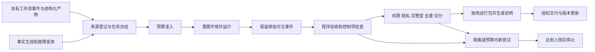

# 闭源 Agent 轨迹与评测数据项目：构建方案与商业结论

> 本文保留 2026-09-24 前一轮研究快照，正文中的实现规模对应当时状态。当前已交付的 300 个多来源任务、真实会话采集、后台运行和评测 API，见[当前系统与实测结果](SYSTEM.zh-CN.md)；商业判断仍有待真实交易和效果实验验证。

这个项目适合独立闭源。个人起步最有把握的切口，是研究 Agent 的证据判断、工具故障和恢复评测：交付可重跑的任务、冻结环境、评分程序及失败诊断，随后积累有明确用途许可的执行轨迹。大规模通用 Agent 训练数据不适合作为第一款商品。

这是一项有条件的产品判断。现有实验已经证明一个小型自动管线能够运行，尚未证明客户愿意购买、数据能提升训练效果或项目能够盈利。目前模型实验只覆盖同一合成家族的三个基础控制变体，三个都通过。这个结果不能证明独立任务覆盖或模型区分度，距离有区分度的付费评测还有内容差距。继续投入应围绕独立任务覆盖、可复现故障与真实付费行为展开。

全项目采用新建的私有仓库。生产流程不依赖访谈、人工标注、人工复核、专家仲裁或异常工单：能按规则判定就接受，无法判定就隔离，预算耗尽就停止。这会限制可覆盖的任务范围，但使个人可以控制长期运营负担。

## 对象和名称

对外建议使用“Agent 执行轨迹与评测数据集”，英文为 Agent Trajectories & Evaluation Dataset。内部程序可以称为数据生产管线。Runtime 是运行代理的环境和执行器；trajectory 是一次任务执行留下的连续记录；workflow records 还可能包括任务规划、评审、验收等工作流记录，完整度未必足以重建一次运行。

| 对象 | 最小组成 | 价值 |
|---|---|---|
| 任务 | 输入、目标、工具、约束、来源与版本 | 定义要解决的问题 |
| 环境 | 可重置状态、冻结材料、工具响应规则 | 支持重跑和公平比较 |
| 轨迹 | 可见输入、动作、工具结果、产物、终止状态 | 定位行为与失败 |
| 评测 | 任务、环境、评分依据、切分、运行协议 | 测量结果和回归 |
| 训练导出 | 满足用途条件的示范或失败恢复样本 | 为特定训练方法提供输入 |
| 商业发布 | 上述资产、数据说明、授权范围、版本和交付方式 | 让买家能够接入和复用 |

一条可以出售的数据应能回答：任务从哪里来、当时看到什么、实际执行了什么、结果如何判定、是否可以用于买家的用途。单独一份 messages.jsonl 通常缺少其中多个条件。

## research-toolkit 可以贡献哪些资产

本次核对的 research-toolkit 版本是 ecd491d54407a67e5ee2a5939cb55518890a25ea。它的评测目录、数据审计和工作流代码提供了三类起点：

- 研究任务与材料包，可用作任务结构和来源边界的参考。
- 正反例、语义诊断对和违规情形，可转成评分器控制项或合成任务的故障条件。
- 评审尝试、原始回复、失败与交付记录，可作为局部过程数据和来源链。

这些对象并不自动构成完整研究 Agent 轨迹。仓库自身区分机械符合性、模型评审和实际研究质量，并说明部分材料只能用于工作流评测；评审者一致也不等于事实正确。已有材料应按原用途和完整度导入，不能把缺少作者工具调用的评审记录改名为完整 runtime 数据。[评测说明](https://github.com/rrrrrredy/research-toolkit/blob/ecd491d54407a67e5ee2a5939cb55518890a25ea/evals/README.md)、[数据审计](https://github.com/rrrrrredy/research-toolkit/blob/ecd491d54407a67e5ee2a5939cb55518890a25ea/docs/evaluation-data-audit.md)

具体迁移方法是：先为原资料建立来源和用途清单；完整任务可生成冻结版本，已知错误转成负控制，局部评审日志进入单独分区；新的实际工作流从任务入口、模型调用、工具返回和产物出口开始采集。新仓库独立维护 schema、评分器和数据，不要求修改或关闭原项目。

## 真实和合成要分别记录，不能用一个标签概括

至少保存 task_origin、execution_mode、actor_kind 三个维度。来自实际业务请求的任务、从已有产物改编的任务和完全合成的任务不同；实际模型执行、脚本控制执行和未执行文本也不同。

没有客户和稳定任务来源时，可使用自己已有工作流的结构化产物，以及自有合成事实。前者先做“产物衍生任务”，只有工作流确实收到原始任务并保留入口记录时，才标为“观察到的任务”。即便有入口记录，记录本身也只是来源证据，不是第三方认证。

自动构建分为两条线。第一条从已知状态向外生成：程序先创建事实表和正确结果，再生成材料、问题和故障变化，最后运行代理。第二条从实际失败向外生成：把超时、失效来源、旧版本优先出现、单位混淆等条件提取为配方，再改变实体、参数和工具返回重新执行。候选轨迹必须经过执行才能成为观察到的轨迹。

建议先做三个深度层次：

1. 结构化事实提取与工具恢复，使用确定性答案和可重置响应。
2. 多来源冲突、时间边界、地区和计费口径变化，先把取舍规则写入题目。
3. 产物完成检查，例如要求的文件、引用、字段或状态是否实际存在。

第三层仍然只是检查具体交付条件。开放式报告的观点深度与综合判断没有同样可靠的自动参考答案。在不引入人的约束下，这类模型评分可以保留为辅助信号，不能包装成专家真值。不同模型相互评审也无法消除共同错误。

不要预先规定“真实 30%、合成 70%”。版本说明应报告独立任务家族、来源分组、变体、执行次数、失败分布，以及各来源所占比例。一个母题改写一千次仍然只有一个主要来源家族。

## 管线和自动决策

个人初期使用一个 Python 仓库、本地文件和一个定时入口即可。持续增长后，再将大对象放入对象存储，将索引与授权记录放入数据库。是否需要队列取决于真实并发量。

每个 run 记录 task_id、family_id、attempt_id、parent_run_id、配置版本、事件时间、模型请求配置、工具结果、实际返回的 usage、评分版本和终止原因。修复必须另建运行，保留第一条失败；目前原型保留原始失败，跨运行的自动修复配对仍是扩展设计。

| 发生什么 | 自动做什么 | 数据如何处理 |
|---|---|---|
| 可重试的工具故障 | 在预定次数和截止时间内重试 | 保留第一次失败和后续恢复 |
| 来源永久不可用 | 验证不可用后弃答 | 判断弃答是否符合任务条件 |
| 答案明确错误 | 保存失败；需要时另起修复运行 | 失败可进入诊断集，不进入成功示范集 |
| 未提交结果或预算耗尽 | 停止执行 | 标为未评定，并另记运行失败 |
| 调用超时且取消状态未知 | 不盲目重发，不返还未知调用预留 | 保存未知状态 |
| 评分依据冲突或控制项失效 | 隔离样本或阻止相应发布 | 不用多数投票强行产生真值 |
| 权限不明、敏感字段、缺失事件或来源不一致 | 按用途拒绝导出 | 不进入人工队列 |
| 再试仍失败 | 达到上限后终止 | 保留尝试关系与原因 |

“执行结束”“成功完成任务”“允许作为训练数据”“可以商业分发”是四个独立结论。管线应分别记录，不能让一个 completed 字段替代全部判断。

评分首先检查可执行状态，其次检查冻结事实和证据，无法确定时保留 unknown。评分器需要已知正确、已知错误和边界控制项。任务不应因评分器暗藏的要求而失败；合理的替代完成路径也不应被错误拒绝。Anthropic 的评测说明支持这种任务、尝试、轨迹和结果的区分，但其开放式评测建议也包含人工校准；本项目的全自动约束要求缩小可声明可靠的评分范围。[Agent 评测实践](https://www.anthropic.com/engineering/demystifying-evals-for-ai-agents)

## 评测集与训练集如何分开

先按共同来源和任务家族切分，再生成变体。改写、重试、故障注入和换模型执行不能跨越训练与隐藏评测边界；实际资料还需要来源、时间和近似重复检查。当前代码实现按调用方提供的来源组和家族切分，尚不能自动发现所有跨来源近似重复。

下载版评测套件包含可运行环境和答案，适合客户本地回归测试。交付之后，它就不再是保密测试集。服务端隐藏评测应保留独立家族，限制重复查询和详细反馈，防止长期试探答案。两种产品必须分别管理。

训练数据至少分成成功示范、失败诊断、失败恢复对和偏好对。后两类需要同题、环境与预算可比较；失败恢复不自动构成严格因果证据。SFT 导出也不代表完成训练，训练收益需要在未参与生产的任务家族上，用相同基础模型和预算进行对照。当前仓库的 SFT 出口是带用途检查的轨迹容器，尚未提供特定训练器格式和训练效果实验。

## 业界参考应该借鉴什么

| 参考 | 一手资料展示的机制 | 本项目的用法 |
|---|---|---|
| SWE-smith | 从软件仓库构造可执行任务并生产训练数据 | 先建立可验证环境，再扩展任务与轨迹 |
| Harbor | 一个任务包含指令、环境和测试；运行对应一次尝试 | 将任务做成可重置、可独立交付的单元 |
| Langfuse | 将观察记录关联到数据集条目与实验 | 分别版本化任务、运行和评分结果 |
| Scale RL Environments | 将模拟应用、材料和验证器组合为产品 | 关注环境和验证规则的价值 |

[SWE-smith](https://swesmith.com/)、[Harbor 任务格式](https://docs.harborframework.com/core-concepts/tasks/overview)、[Langfuse 数据集](https://langfuse.com/docs/evaluation/experiments/datasets)、[Scale RL Environments](https://scale.com/rlenvironments)

这些资料说明行业在建设任务、环境、轨迹和验证体系，并不能证明纯日志转售有稳定利润。Scale 的官方描述明确包含专家制作内容，因此不能把它当作全自动生产已被验证的证据；这里借鉴的是产品组成。上述资料也没有给出适用于个人项目的通用售价或盈利保证。

## 卖什么，怎样验证愿意付费

最先服务研究 Agent、检索问答和工具调用应用的开发者：他们需要在换模型、改提示词或改工作流后发现回归。这是待验证的客户假设。个人更容易提供一个边界清楚、安装和运行成本低的评测产品，而不是满足大型模型公司的定制采购、规模和交付要求。

建议按以下顺序商业化。表中的价格只是首轮实验区间，未经过成交验证，也不是行业报价。

| 顺序 | 交付物与授权单位 | 价格实验 | 放大的前提 |
|---|---|---|---|
| 首款商品 | 一版可下载评测包，按组织内部使用授权 | 299—999 元/版 | 用户成功运行，并发生真实购买 |
| 持续收入 | 明确周期与覆盖范围的更新订阅 | 199—499 元/月 | 旧买家实际使用更新并续费 |
| 后续服务 | 服务端隐藏评测，按任务尝试扣额度 | 基于实测成本定价 | 有稳定请求量和明确金额上限 |
| 更晚阶段 | 专项训练轨迹、恢复对或环境许可 | 依据用途、范围和效果单独定价 | 权利明确，且有买方可复现的训练收益 |

同一数据的内部评测、训练、再分发和独占使用是不同授权范围。初期尽量采用标准化、非独占的评测授权；独占交易可能限制重复销售并增加维护负担，不适合默认开启。

不安排线下访谈。通过公开的产品说明、可下载试用样例、可自动运行的示例和结账页面验证购买行为；实现可以闭源，说明和有限试用资产按专有条款展示。未经主动授权，不上传用户的完整任务或数据。使用统计应说明用途并提供退出方式；本地运行量不能在没有遥测时被假定已经采集。

验证链为：相关访问 → 试用获取 → 成功运行或主动返回运行收据 → 发起结账 → 实际支付 → 使用新版或续费。每一层都应有定义和分母。只有浏览没有下载，优先检查定位；下载后跑不起来，先修接入；能运行却没有付费，检查问题价值、样例区分度和价格。关注不同行为，才能减少无效扩产。

可以把“30 天或预定获客支出上限”为第一轮实验边界。若已有 20 个独立组织成功使用试用包，却没有任何成交，就停止扩充数据量，修改商品范围或价格后再做一轮；若连有效使用都没有，结论是分发或接入未验证。这个阈值是个人控制投入的建议，不是统计证明，不代表项目一定失败。机器人、重复访问、自己测试和免费领取不能算成交证据。

## 成本、定价与个人运营

成本应计入全部成功、失败、隔离和修复运行，按最终可交付的独立任务家族摊销。评测服务还需核算每次实际尝试，包括重复请求、评分和环境启动。

单批单位成本 = 全批生成、执行、验证、修复和存储费用 ÷ 可交付独立家族数。

例如一批花费 300 元，交付 20 个家族时是 15 元/家族，交付 5 个时是 60 元/家族。这是算术示例。销售单价并不直接等于利润：还要扣支付、退款、获客、基础设施和维护支出。数字包可以重复销售，但更新订阅也带来持续生产义务。

每次调用前预留预算，收到可计费用量后结算，费用未知时保留预留。金额预算必须使用有依据的价格和可控制的输入、输出及工具上限，不能用平均 token 消耗承诺硬金额上限。本地 Codex 登录当前能提供调用次数和返回用量，未提供实际账单金额，所以现有系统执行步骤、时间、批调用和月调用上限，不声称已经实现人民币或美元硬限额。

一次实际批次中，同一任务家族的三个基础变体使用七次模型调用，返回输入 76,725 tokens，其中包含 8,320 cached input tokens，输出 444 tokens。缓存数是输入的一部分，不能重复相加。实际账单金额未知。对这么简单的提取任务，约 1.1 万输入 tokens/调用提示包装和上下文成本值得优化；这个判断来自这一次受控实验，不能推成所有任务的成本规律。

个人起步建议把内容目标限制为一个领域、一个任务协议、一个验证方法，先形成约 20—50 个独立家族的候选集，每个家族保留少量有解释价值的变体；这只是工作规模建议，发布取决于覆盖和可运行性。当前模型实验只有一个基础任务家族，还达不到这个内容目标。扩产只在新增任务覆盖不同失败、买家能复现其价值且成本可控时发生。

全自动指日常采集、执行、判定、隔离和交付规则自动运行。经营者仍需配置服务账号、许可条款、产品范围和预算；自动化不能自行产生商户资格、数据授权或客户。

## 闭源策略和容易遗漏的因素

私有仓库应保存生成配方、评分器、完整轨迹、隐藏评测、成本信息和客户授权记录。对外只按相应产品许可交付必要的客户端、任务和数据。Python 客户端被授权交付，并不等于开源；但交付出去的代码和答案无法继续作为买家不可见的秘密。

research-toolkit 的 MIT 许可允许相应软件的使用、修改和分发，并要求保留适用声明。它不能替第三方资料、个人信息或模型服务输出作出再销售授权；新项目独立闭源也不会扩大这些权利。[项目许可证](https://github.com/rrrrrredy/research-toolkit/blob/ecd491d54407a67e5ee2a5939cb55518890a25ea/LICENSE)

还应把以下因素纳入自动规则和产品说明：

- **真实性与许可分开。** 真正发生过的轨迹，也可能不允许训练或转售。配置里的 allowed_uses 是使用政策声明，不是法律权利凭证。
- **时间变化。** 保存材料时间和快照；网页更新造成的变化不能全部归咎于模型。不能保存或分发的材料，换成自有构造材料，明确衍生关系。
- **数据删除。** 上游资料撤回时，要能追踪其任务、轨迹和发布版本，停止后续分发并发布撤回清单；不能承诺远程抹除已经售出的副本。
- **隐私。** 凭据过滤只能覆盖已定义模式。全自动且不引入人工审核时，起步优先处理自有、非个人、结构化资料；无法建立可接受处理规则的来源不接入。
- **安全与作弊。** 工具输出按不可信数据处理。恶意材料、评分器被读到、答案泄漏和沙盒不足都会污染结论。当前命令适配器只面向可信本地程序，不是隔离不可信买家代码的云服务。
- **失败选择偏差。** 要保留失败、超时和隔离原因，不能只统计成功导出的轨迹；同一家族的多个变体也不是独立样本。
- **效果和收入分别验证。** 运行通过不证明任务难度；评分稳定不证明训练有效；训练有效也不证明有人按预期价格购买。

## 已交付成果与结论边界

新仓库已提供合成任务、结构化产物事实入口、实际模型调用捕获、脚本控制、失败保留、确定性判定、按家族切分、用途门禁、可恢复批次、月调用预留、定时触发入口，以及可离开工厂仓库运行的评测 ZIP 导出。

定时入口可以交给操作系统调度器重复触发，同一时间窗口不重复执行。它不是已经安装并常驻的线上服务。下载包默认只供内部评测；商业分发必须明确拥有相应用途权限，模型轨迹不因评测任务打包而被顺带授权。

当前没有销售流水、训练增益结果、生产支付服务或外部客户任务。新增真实来源示例取自项目自己的运行产物，属于产物衍生任务。新示例的外部模型验证未执行：自动审批拒绝了该次数据发送；新增入口及独立评测包采用本地控制验证，之前的真实模型批次另有原始记录。

因此，当前应作出的决定是：保留新项目完全闭源，沿“可自动验收的研究 Agent 评测”推进；先完善有区分度的小型任务套件并开展自助购买实验，再根据有效使用、真实成交、重复使用和单位成本决定扩产。大量堆积基础合成轨迹、提前投入通用数据平台或以未经证明的训练收益定价，都缺少现有证据支持。

附：用户提供的微信公众号文章因访问验证未能读取，未用于上述结论。
