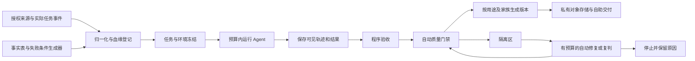

# 私有 Agent 执行轨迹数据仓库：自动生产、自动验证、自助销售

版本说明：本文记录产品设计与初始实现范围。v0.2 已接通实际 Codex 模型调用和有限自动批次；最新能力、运行命令及实测结果见[运行说明](RUN.zh-CN.md)。第 11 节保留 v0.1 初始实现边界。

新项目采用独立的私有仓库，代码、任务、数据、评分器、隐藏测试和生产配方全部闭源。产品名称建议用“Agent 执行轨迹与评测数据集”，英文为 Agent Trajectories & Evaluation Dataset；内部生产系统可以叫 Agent Data Factory。Runtime 指执行这些任务的环境和运行程序，trajectory 指一次执行实际留下的行为记录。

产品的生产链不安排访谈、人工标注、人工复核、专家裁判或人工异常队列。程序无法判定的样本进入隔离区；自动重试与复判到达预算上限就停止。这个约束决定了第一阶段应该选择有明确证据和可执行验收条件的任务，而不把“所有开放式研究报告都能自动判断优劣”当作前提。

## 1. 闭源仓库应该积累什么

核心资产是“可复现的任务 + 环境 + 实际轨迹 + 结果 + 标签依据 + 使用权限”。日志条数容易增长，能重跑、能解释失败、能验证改进的数据更难替代。

| 对象 | 保存内容 | 对外产品用途 |
|---|---|---|
| 任务集 | 目标、材料、约束、工具、验收条件、母题与版本 | 训练输入和评测题目 |
| 执行轨迹 | 可见输入、输出、工具调用、返回结果、状态变化、预算停止 | 行为训练、故障定位 |
| 决策记录 | 观察到什么、选择继续/重试/换源/弃答/结束、可见理由和结果 | 决策与恢复样本 |
| 评测包 | 任务、可重置环境、评分程序、运行协议、隐藏切分 | 回归测试、模型与框架比较 |
| 训练导出 | 合格示范、失败与修复对、可靠偏好对、逐步奖励依据 | SFT、偏好学习、其他训练 |
| 发布清单 | 来源血缘、允许用途、覆盖范围、已知缺陷、版本与校验信息 | 客户复用与版本更新 |

只记录实际可见的动作和理由。需要解释字段时，在运行当时让代理输出简短的结构化理由；不能事后编一段“内部思考”冒充原始过程。

research-toolkit 可以提供研究任务结构、来源与主张关系、评审记录、失败保存方式和交付条件等设计参考。已有工作流资料并不等于完整运行轨迹；本项目通过独立适配器读取明确指定的记录，缺失字段保持缺失。[共享工作流源码](https://github.com/rrrrrredy/research-toolkit/blob/ecd491d54407a67e5ee2a5939cb55518890a25ea/scripts/research_workflow.py)

新代码和新资产在此私有仓库内演进。若以后复制第三方代码，保留适用的第三方许可与声明；仓库设为 private 不能扩大原始材料的使用权限。

## 2. 真实与合成分三个维度记录

“真实”至少有三个含义，应该分别存字段：

| 维度 | 推荐取值 | 不能混淆的情况 |
|---|---|---|
| 任务来源 | 实际任务 / 衍生改编 / 合成任务 | 定时让模型编题仍然是合成任务 |
| 执行来源 | 实际观察 / 冻结环境重跑 / 未执行文本 | 真的执行过合成题，可以得到实际运行轨迹 |
| 执行主体 | 模型 / 脚本控制 / 原始资料不完整 | 脚本跑通不能算模型完成任务 |

起步阶段，真实数据来自你自己已经在运行的、拥有相应权限的 Agent 工作流。适配器在任务入口、模型调用、工具调用和产物出口采集事件，自动记录失败，不要求新增人来提供任务或补标签。不能捕获完整调用的旧日志，仅作为局部工作流资料保留。

没有实际业务任务时，也可以先生产“合成任务上的实际模型轨迹”，但产品说明必须如实标识。真实需求占比暂时为零不会被改名包装成真实业务数据。

合成数据沿两条路线生成：

1. **从已知事实向外生成。** 先创建结构化事实表和验收规则，再生成不同表述的材料及问题，最后真的执行代理。答案由事实表和程序状态决定，减少生成器自己写题、自己猜答案的循环。
2. **从已观察失败向外变形。** 把一条失败抽象成可复现条件，例如来源失效、过期版本优先出现、计费单位相近、必要字段缺失。自动改变实体、数值、表述和工具响应，生成同一母题的变体。变体重新执行、重新判定，不能沿用母样本的成功标签。

文本生成器输出的“完美工具调用记录”只能当候选脚本，经过执行后才能进入轨迹数据集。环境若不支持执行，就不标记为已经发生。

不规定一个看似精确的“真实 30% + 合成 70%”比例。每个版本分别报告任务来源、独立母题数量、运行次数、变体数和失败分布；根据覆盖缺口决定下一批生产什么。

## 3. 第一批任务选可自动验收的证据决策

建议先覆盖研究 Agent 的具体决策：已有材料是否足以回答；工具故障是否值得重试；旧资料与新资料如何取舍；来源不可得时是否停止断言。这与原项目积累相近，也便于把判定写成程序。

| 任务家族 | 输入变化 | 自动验收条件 |
|---|---|---|
| 状态混淆 | “计划支持”与“已经支持”并存 | 输出状态与指定日期的事实表一致 |
| 口径混淆 | 按用户、工作区、请求计费 | 数值、单位、周期都一致 |
| 缺失证据 | 404、必要字段缺失 | 实际访问后弃答，不填造信息 |
| 工具恢复 | 429、超时、暂时不可用 | 在重试预算内恢复，保留首次失败 |
| 来源冲突 | 新旧版本或授权等级不同 | 依据预先定义的任务规则选择版本 |
| 约束变化 | 途中追加地区、日期、禁止来源 | 最终产物和后续动作遵守新约束 |
| 无效成功 | 自称完成但目标文件/状态不存在 | 实际产物或最终状态验收失败 |

当前代码只实现前三类中的基础事实、证据缺失，以及一次 429 后恢复的控制场景。其余是扩展方向，不能列入现有数据覆盖数。

先用冻结材料和模拟工具响应控制变量，再接入有许可、可保存快照的外部来源。开放网页会变化；若没有稳定快照与时间边界，昨天和今天的答案差异不一定来自模型能力。

## 4. 管线全部自动运行，异常停在机器状态里

目标管线：

第一阶段一个 Python 项目、本地文件、JSONL 和一个定时入口就足够。结构化索引可以逐步加 SQLite；数据规模需要时再换对象存储和任务队列。不要先为尚不存在的并发量搭完整平台。

建议模块分别承担以下职责：

- **Capture：** 在实际运行边界记录原始可见消息、工具请求/返回、产物引用、模型身份、usage、错误和截断情况。没有收到的 usage 为 unknown。
- **Normalize：** 转成统一 schema；引用大对象；记录来源、转换版本、去重指纹和任务家族。
- **Generate：** 从事实表及已观察的失败条件生成候选任务；生成器不能把待测代理的答案直接写进其可见输入。
- **Execute：** 重置环境、限制工具、控制调用预算、记录每次尝试；新尝试新建 run，原始失败不覆盖。
- **Verify：** 比对事实、最终文件、数据库状态或可执行测试；开放问题按下节处理。
- **Curate：** 检查权限、隐私规则、轨迹完整性、标签来源、重复和切分；自动接受或隔离。
- **Release：** 生成训练包、诊断包或评测包，各自应用规则；附版本清单和覆盖统计。
- **Deliver：** 支付或订阅状态触发授权下载/API 配额，自动更新与失效。

每个自动任务都需要幂等键、最大尝试数、截止时间、终止原因和断点。发生“超时但不知远端是否取消”的调用时，先保留未知状态，不能无限重发并把费用当成零。

v0.2 已把命令行步骤组合为有限自动批次；全天候定时调度、云队列、支付或收费 API 尚未提供。

## 5. 决策机制与失败机制

生产流程中的“处理失败”与数据中的“代理做错”要分开：

| 事件 | 自动处理 | 保留标签 |
|---|---|---|
| 工具短暂故障 | 在次数和时间预算内重试；可用时切换已许可来源 | 工具错误、重试次数、恢复结果 |
| 答案明确错误 | 保存原轨迹；可另起修复运行 | 错误类型、证据、原 run 与修复 run 的关联 |
| 工具不可用且无法完成 | 停止或提交证据不足 | 弃答是否合理、最终完成状态 |
| 无答案但运行记录完整 | 进入运行故障诊断数据 | task outcome = not_assessed，不伪造答案分数 |
| 标签判定冲突 | 固定次数复判或换验证方法 | uncertain；未解决则隔离 |
| 轨迹缺片段或哈希不一致 | 隔离该记录 | incomplete / inconsistent |
| 来源许可不匹配或未知 | 自动拒绝该用途的导出 | rights_not_established |
| 预算耗尽、重复循环 | 终止当前运行 | 首次故障、步骤数、已知成本、缺失成本 |
| 自动修复再次失败 | 到达预算后终止 | 全部尝试链和终止原因 |

标签优先级是：**可执行状态验收 → 冻结事实与证据核验 → 有校准依据的模型判断 → unknown。**

对长文质量、观点深度等缺少确定答案的属性，可以用不同模型做批评、对照和一致性检查，标签明确写为“模型判断”。多个模型同意并不证明结论真实。高风险或规则之外的样本保留 unknown，不进入声称有可靠参考答案的评测包。

自动修复必须有可观察目标，比如补全缺失字段、重跑失败工具、重新验证引用。只修改输出以迎合裁判、直到拿到高分，会造成奖励投机。评分器也需要已知正确、已知错误和边界控制项；当它无法区分这些控制项时，自动停用对应标签或隔离整批。

失败与恢复对适合生产，但“修复成功”必须由新的运行和结果支持。偏好对还要求任务、环境和预算具有可比性；不能仅凭一条成功、一条失败就推断所有差异都由某个决策造成。

## 6. 切分、质量与真实性决定数据是否可卖

先按任务母题及共享来源划分开发、训练和隐藏测试，再派生变体。来自同一任务的重试、换模型运行、改写和故障注入不能跨切分。真实资料还要按来源、时间和近似重复关系合并家族；仅对行 ID 做随机划分不够。

隐藏测试不进入可下载的训练包。内部诊断包可以包含完整轨迹和解答，但它一旦交给买家，就不再适合用作同一买家的隐藏能力评测。对外评测可以只发布示例和评分说明，把隐藏任务通过托管接口执行。

每个版本至少自动生成这些统计：

- 独立母题数，以及任务、变体、运行、事件四种数量。
- 来源类别、模型/脚本主体、环境类别与可见采集覆盖率。
- 失败类型分布，包含预算终止和无法判断的分母。
- 重跑一致性、标签冲突率、去重后保留率与自动隔离原因。
- 有证据支持的改进效果；只有在未用于调参的任务家族上比较，才能说明迁移效果。
- 实际费用与未知费用占比；不能省略失败尝试成本。

质量的代价是会丢弃一部分难以验证的候选样本。全自动路线可以优先保证可复现性和标签可信边界，逐步扩展覆盖范围。不能同时承诺“开放问题全覆盖、绝不误判、完全无人介入”。

## 7. 个人如何通过自助产品盈利

首个商品建议是一个范围清楚的私有数据包：例如“研究 Agent 证据不足与工具恢复任务包”。买家拿到可运行环境、许可明确的材料、评分程序、失败分类，以及可选的轨迹训练部分。它应当让买家的开发流程更快发现问题，或者用可复验实验支持训练收益。

| 产品 | 收费单位 | 自动交付方式 | 起步顺序 |
|---|---|---|---|
| 版本化数据/评测包 | 每个版本或用途许可 | 支付完成后发授权下载链接 | 优先 |
| 持续更新订阅 | 每月/季度新增家族和场景 | 固定周期构建、校验、发布 | 有稳定更新后 |
| 托管评测 API | 每次评测、额度或订阅 | 提交代理端点/指定接口，自动执行评分 | 接口稳定后 |
| 训练数据扩展包 | 任务家族、用途、更新权限 | 自动生成并导出允许用途的子集 | 有训练效用证据后 |
| 可执行环境授权 | 环境版本、运行额度 | 包下载或受控远程环境 | 环境覆盖成熟后 |

以上是产品方案，不是已证实的收入。训练许可、再分发许可与评测使用权可以分开报价；不要把数据条数作为唯一价格基础，近似重复的一万条轨迹可能不如少数新的故障家族有用。

验证购买意愿可以完全在线完成：发布少量有明确许可的演示样本和实际运行对比，页面说明交付内容、适用边界和固定价格，设置自助下载或可真实交付的付费入口。代码仓库保持私有。只依据访问→演示运行→购买→重复使用/续费这些行为调整产品，不安排访谈或人工诊断服务。

如果还没有真实买家，先展示现成可下载成果；尚未开发的服务不要写成已提供功能。订阅必须有稳定交付内容，不能先收钱再依赖临时人工补货。当前仓库没有上线销售页面或收款功能。

不建议现在虚构一个“行业标准报价”。可在小规模上线时测试固定价格，但试验价、折扣和购买结果都应单独记录。收费假设是否成立，由实际购买与成本决定。

## 8. 成本用合格家族计算，失败费用全部计入

单个可交付家族的变动成本：

> （任务生成 + 全部成功/失败执行 + 自动验证 + 自动修复 + 存储与带宽）÷ 最终可交付独立家族数

例如，某批次计算与存储总支出为 300 元，得到 20 个可交付家族，平均成本为 15 元/家族。若隔离更多样本，最后只剩 5 个，成本变为 60 元/家族。这只是算术示例，不是本项目实测成本。

商业毛利还需要减去支付渠道、退款、获客、基础设施等支出。数字包可以多次销售，但持续更新、支持兼容性和维护系统也会产生费用；不能把一次生成费用与一次售价简单相减就当成长期利润。

自动预算分三层：每个任务最多花多少、每批最多花多少、每月最多花多少。模型调用前先预留预算，返回后按实际 usage 结算；未知费用先保留预留额。价格表和模型版本必须记录，达到上限自动停产。当前代码只有步骤、时间和工具重试上限，货币预算预留尚未实现。

## 9. 构建顺序与自动扩大/停止条件

下面是建议的实施顺序，时间长短取决于模型接口和数据来源；不把它当成交付或收入保证。

| 阶段 | 可验收结果 | 自动扩大或停止条件 |
|---|---|---|
| 本地控制管线 | 任务生成、真实控制执行、失败保留、自动评分、切分、导出 | 控制项错误或来源不明就停止该批导出 |
| 模型与实际事件采集 | 实际模型版本、可见消息、工具结果、usage、完整度标记 | 身份/日志不完整的运行不得混入完整模型轨迹 |
| 任务覆盖扩展 | 新故障家族、独立来源分组、冻结环境与可重跑验证 | 去重后没有新增覆盖或成本超预算就停产 |
| 产品导出 | 用途明确的训练/评测包、机器生成的数据说明、可执行示例 | 训练测试泄漏、许可不匹配、验证退化则阻止发布 |
| 自助销售 | 页面、支付、授权下载、到期与更新机制 | 依据转化、复购和单位成本决定更新频率 |

对个人最重要的限制是并行范围。先做好一个任务领域和一种运行接口，把收集事件、执行、判定、隔离和打包连起来，再增加模型和领域。每个模型或环境扩展都带来新的费用与复现问题。

## 10. 可借鉴的业界做法

借鉴的是可复用的工程机制，不推定其他公司也采用无人生产。

| 参考 | 可借鉴机制 | 本项目采用方式 |
|---|---|---|
| Anthropic 的 Agent 评测实践 | 区分任务、尝试、轨迹、最终结果，组合不同评分器 | 运行状态与答案质量分开记录；不把代理自称完成视为完成 |
| SWE-smith | 在可执行软件环境中构造任务并验证解法 | 先有可执行验收，再扩展任务变体与轨迹 |
| Harbor / ATIF | 任务环境与轨迹交换格式 | 保留可见消息、工具事件、模型与用量等字段的映射空间 |
| Langfuse 数据集与实验 | 数据集条目和实验运行关联 | 任务版本、运行版本、评分版本分离，持续比较变化 |
| Scale 的 RL environments | 把可运行环境作为产品组成部分 | 逐步销售可执行任务环境，避免只有静态文本 |

相关一手资料：[Anthropic](https://www.anthropic.com/engineering/demystifying-evals-for-ai-agents)、[SWE-smith](https://github.com/SWE-bench/SWE-smith)、[Harbor ATIF](https://github.com/harbor-framework/harbor/blob/main/rfcs/0001-trajectory-format.md)、[Langfuse](https://langfuse.com/docs/evaluation/experiments/datasets)、[Scale](https://scale.com/rlenvironments)。这些资料支持机制参考，不能证明本项目存在需求、已盈利或已经提升模型能力。

## 11. v0.1 初始实现边界（历史记录）

当前可运行的是标准库 Python 控制管线：合成事实任务、脚本策略与可信外部命令协议、可见事件记录、确定性评分、运行失败保留、按家族切分、用途门禁和隔离导出。默认训练导出排除脚本控制数据，也排除无法证实模型来源的外部命令数据。

已有 research-toolkit 日志只能窄范围导入评审元数据，标识为局部记录、权限未核实并隔离。它不会被改造成完整真实轨迹。本地一致性校验不能证明日志没有被拥有写权限的人伪造；简单凭据过滤也不等于完整隐私检测。

完整模型调用捕获、真正的实际任务入口、自动模型复判、冻结环境发布、跨来源去重、货币预算、无人调度和商业交付仍需实现。当前成果可以验证本地数据流与规则，不能作为已经具备生产级真实数据、可销售训练价值或经营收入的证明。
